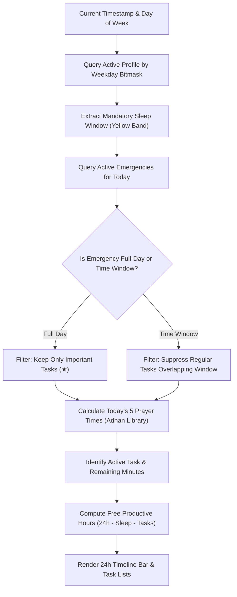

# Dayflow ⏳

> **Smart, Local-First Routine, Task & Emergency Daily Planner**  
> Built with **React Native**, **Expo SDK 52**, **Drizzle ORM**, **SQLite**, and the **Cairo** typography system.

---

## 📑 Table of Contents

1. [Overview & Philosophy](#-overview--philosophy)
2. [Key Features](#-key-features)
   - [Today View & 24-Hour Visual Timeline](#1-today-view--24-hour-visual-timeline)
   - [Profiles Engine & Routine Architect](#2-profiles-engine--routine-architect)
   - [Emergency Mode & Schedule Suspensions](#3-emergency-mode--schedule-suspensions)
   - [Islamic Prayer Times & Relative Reminders](#4-islamic-prayer-times--relative-reminders)
   - [Bilingual Arabic & English UI with Full RTL](#5-bilingual-arabic--english-ui-with-full-rtl)
   - [Custom Modals & Thoughtful UX](#6-custom-modals--thoughtful-ux)
   - [Android Home Screen Widgets](#7-android-home-screen-widgets)
   - [Privacy, Offline-First & JSON Backups](#8-privacy-offline-first--json-backups)
3. [System Architecture & How It Works](#-system-architecture--how-it-works)
   - [Daily Routine Resolution Pipeline](#daily-routine-resolution-pipeline)
   - [Non-Overlap Validation Algorithm](#non-overlap-validation-algorithm)
   - [Emergency Filtration Logic](#emergency-filtration-logic)
   - [Database Schema (Drizzle ORM + SQLite)](#database-schema-drizzle-orm--sqlite)
4. [Project Structure](#-project-structure)
5. [Tech Stack & Dependencies](#-tech-stack--dependencies)
6. [Getting Started & Installation](#-getting-started--installation)
   - [Prerequisites](#prerequisites)
   - [Setup Steps](#setup-steps)
   - [Running the App](#running-the-app)
7. [Testing & Quality Assurance](#-testing--quality-assurance)
8. [License](#-license)

---

## 🌟 Overview & Philosophy

**Dayflow** is a daily routine manager engineered for people who value their time, natural sleep cycles, prayer schedule, and adaptability when life happens. 

Most calendar and to-do apps either treat your day as an endless to-do list without time constraints or force you into rigid blocks that collapse whenever an unexpected emergency occurs. Dayflow bridges this gap with a **structured, profile-based routine engine**:

- **Zero Cloud Dependence**: 100% of your data remains on your physical device in an embedded SQLite database.
- **Sleep-First Scheduling**: Mandatory sleep window configuration protects your biological clock before scheduling productive tasks.
- **Conflict & Overlap Free**: Strict algorithms guarantee that your routine contains zero overlapping commitments and no conflicting profile assignments.
- **Emergency-Resilient**: Unexpected urgent events can pause regular tasks without deleting your predefined weekly routines, preserving critical ("Important") commitments while suppressing non-essential tasks.
- **Prayer-Aware**: Deep integration with the [adhan](https://github.com/batoulapps/adhan-js) library provides accurate Islamic prayer calculations across multiple calculation methods, along with prayer-relative reminders.
- **First-Class Arabic & English Experience**: Complete bilingual experience featuring true RTL (Right-to-Left) mirroring, Arabic-Indic numerals, and typography powered by the Cairo font family.

---

## ✨ Key Features

### 1. Today View & 24-Hour Visual Timeline

The **Today** screen ([`src/app/(tabs)/today.tsx`](file:///d:/Git/Apps/dayflow/src/app/(tabs)/today.tsx)) acts as the cockpit for your day:

- **Continuous 24-Hour Timeline Bar** ([`DayTimelineBar.tsx`](file:///d:/Git/Apps/dayflow/src/components/timeline/DayTimelineBar.tsx)):
  - Visual horizontal bar rendering all 24 hours of the day (00:00 to 24:00).
  - Displays color-coded task blocks, prayer time markers, and a dedicated yellow/gold band for the mandatory sleep block.
  - Live animated red vertical pointer indicating the current time of day.
- **Interactive Timeline Legend**:
  - Automatically lists every active task and its distinct color directly below the timeline bar for immediate glanceability.
- **Active Task Spotlight**:
  - Highlights the current ongoing task with start and end times, remaining countdown minutes, and instant access to nested subtasks.
- **Free Time Counter**:
  - Real-time computation of remaining unallocated productive hours during your waking day, helping you avoid overbooking.
- **Foldable Daily Tasks List**:
  - Collapsible list displaying today's scheduled tasks with duration badges, category tags, importance stars, and checklist subtasks.
  - Subtask completion is saved instantly to SQLite.
- **Foldable To-Dos Section**:
  - Distinct collapsible list for to-do items. Checkbox-only completion toggle prevents accidental clicks.
  - Clicking any to-do opens its full details view.
- **Today-Only Ad-hoc To-Dos**:
  - Quickly capture unexpected to-dos for today without editing recurring profile routines.
  - Includes inline editing directly inside the details modal, category assignment, importance flag, and reminder configuration.

---

### 2. Profiles Engine & Routine Architect

The **Profiles** screen ([`src/app/(tabs)/profiles.tsx`](file:///d:/Git/Apps/dayflow/src/app/(tabs)/profiles.tsx)) lets you design custom daily templates (e.g., *Workday*, *Weekend*, *Remote Day*, *Study Schedule*):

- **7-Day Bitmask Activation**:
  - Profiles are mapped to days of the week (Saturday through Friday) using efficient bitmask flags.
  - Active conflict prevention: The app blocks assigning an active day if that day is already claimed by another active profile.
- **Mandatory Sleep Window**:
  - Every profile requires a designated sleep span (`sleepStart` to `sleepEnd`, e.g., 23:00 to 07:00).
  - Sleep is rendered as a distinct fixed yellow/gold block on the visual timeline.
- **Zero-Overlap Task Enforcement**:
  - Tasks within a profile cannot overlap (e.g., Task A from 10:00–12:00 and Task B from 11:00–13:00 is rejected with a validation error).
- **Automated Distinct Task Colors**:
  - Eliminates cumbersome manual color pickers.
  - The app automatically assigns a distinct, harmonized color from a 12-color curated palette to each task in the profile.
- **Subtasks & Reminders**:
  - Break tasks into step-by-step checklist subtasks.
  - Attach time-relative or prayer-relative reminder alerts to both tasks and to-dos.

---

### 3. Emergency Mode & Schedule Suspensions

Real life doesn't always go according to plan. The **Emergencies** module ([`src/app/(tabs)/emergencies.tsx`](file:///d:/Git/Apps/dayflow/src/app/(tabs)/emergencies.tsx)) provides dynamic schedule alterations:

- **Flexible Targets**:
  - **Specific Date**: Suspend a single calendar day (e.g., doctor visit, family emergency on 2026-11-15).
  - **Recurring Weekdays**: Suspend schedules on recurring weekdays (e.g., every Monday evening).
- **Full-Day or Custom Time Window**:
  - Select 24-hour total suspension or define a specific time span (e.g., 14:00 to 18:00).
- **Priority-Aware Task Preservation**:
  - Normal non-essential tasks falling within the emergency time window are suppressed.
  - Tasks marked with the **Important (★)** flag stay active, ensuring essential obligations (medications, crucial appointments) are never missed.
- **Reversible & Safe**:
  - Profiles are never permanently deleted or corrupted. Disabling or deleting an emergency immediately restores your original schedule.

---

### 4. Islamic Prayer Times & Relative Reminders

Dayflow integrates prayer times into your daily productivity:

- **Adhan Engine Integration** ([`src/services/prayer.ts`](file:///d:/Git/Apps/dayflow/src/services/prayer.ts)):
  - Automatically calculates the 5 daily Muslim prayers: **Fajr**, **Dhuhr**, **Asr**, **Maghrib**, and **Isha**.
  - Uses GPS location via `expo-location` or manual latitude/longitude coordinates.
  - Supports multiple calculation authorities:
    - Egyptian General Authority of Survey
    - Muslim World League (MWL)
    - Umm Al-Qura University, Makkah
    - Islamic Society of North America (ISNA)
    - University of Islamic Sciences, Karachi
    - Dubai / Moonsighting Committee / Kuwait / Qatar / Singapore
- **Prayer-Relative Reminders**:
  - Configure alerts relative to any prayer time with positive or negative offsets (e.g., *15 minutes before Fajr*, *10 minutes after Maghrib*).
  - Automatically recalculates dynamic notification triggers based on daily astronomical shifts.

---

### 5. Bilingual Arabic & English UI with Full RTL

Dayflow is built from the ground up for both Arabic and English speakers:

- **Dynamic Directionality**:
  - True Right-to-Left (RTL) layout mirroring when Arabic is active, and Left-to-Right (LTR) for English.
  - Configurable directly from Settings ([`src/app/(tabs)/settings.tsx`](file:///d:/Git/Apps/dayflow/src/app/(tabs)/settings.tsx)) without requiring device system language changes.
- **Arabic-Indic Numerals**:
  - When in Arabic locale, numbers and timestamps can display in standard Arabic-Indic digits (`٠١٢٣٤٥٦٧٨٩`) via localized formatters ([`src/i18n/formatters.ts`](file:///d:/Git/Apps/dayflow/src/i18n/formatters.ts)).
- **Cairo Font Family**:
  - Embedded `@expo-google-fonts/cairo` typography ensures consistent, legible, and modern Arabic and Latin typography across all components.

---

### 6. Custom Modals & Thoughtful UX

Every modal and interaction in Dayflow is designed for comfort and predictability:

- **Unified Custom Confirmation Modal** ([`ConfirmModal.tsx`](file:///d:/Git/Apps/dayflow/src/components/common/ConfirmModal.tsx)):
  - Replaces generic platform `Alert.alert` with a themed modal matching app colors, Cairo typography, and custom action buttons.
  - Used consistently for all destructive actions (profile, emergency, task, to-do, and subtask deletions).
- **Dismiss by Clicking Outside**:
  - All non-fullscreen modals and alert popups can be dismissed simply by tapping the backdrop outside the dialog card.
- **Smooth Nested Scrolling**:
  - Configured with `nestedScrollEnabled` and keyboard-aware touch handling to prevent touch blocking or scrolling glitches.
- **Smart Time Pickers** ([`SmartTimePicker.tsx`](file:///d:/Git/Apps/dayflow/src/components/time/SmartTimePicker.tsx)):
  - Clean numeric time selection for start and end times with 12h/24h support.

---

### 7. Android Home Screen Widgets

Powered by `react-native-android-widget`:

- **Active Task Widget** ([`ActiveTaskWidget.tsx`](file:///d:/Git/Apps/dayflow/src/widgets/ActiveTaskWidget.tsx)):
  - Displays current ongoing task, progress indicator, and next upcoming event right on your Android home launcher.
- **Day Timeline Widget** ([`DayTimelineWidget.tsx`](file:///d:/Git/Apps/dayflow/src/widgets/DayTimelineWidget.tsx)):
  - Renders a mini 24-hour routine bar reflecting your scheduled tasks and sleep block.

---

### 8. Privacy, Offline-First & JSON Backups

- **Local-First SQLite Engine**:
  - Utilizes `expo-sqlite` and `drizzle-orm` for fast, ACID-compliant local database operations.
  - Zero telemetry, no third-party cloud analytics, and no accounts required.
- **Export & Import Backup Engine** ([`src/services/backup/`](file:///d:/Git/Apps/dayflow/src/services/backup/)):
  - Export full app data (profiles, tasks, to-dos, emergencies, settings) to a portable `.json` file.
  - Import and restore data with automated schema validation.
  - Integrated with Android Storage Access Framework (SAF) and system share sheet.

---

## 🏗 System Architecture & How It Works

### Daily Routine Resolution Pipeline

Every time the **Today** screen opens or the app wakes up, the domain engine (`src/domain/resolveDay.ts`) executes a deterministic 6-stage resolution pipeline:



---

### Non-Overlap Validation Algorithm

To prevent conflicting schedules, Dayflow executes a continuous interval validation whenever tasks are created or updated ([`src/domain/conflicts.ts`](file:///d:/Git/Apps/dayflow/src/domain/conflicts.ts)):

$$\text{Overlap}(A, B) \iff \max(\text{start}_A, \text{start}_B) < \min(\text{end}_A, \text{end}_B)$$

- Tasks with overnight spans (e.g., 23:00 to 02:00) are safely normalized across midnight boundaries.
- The UI immediately reports the exact conflicting task name and time range to the user.

---

### Emergency Filtration Logic

When an emergency is active, the engine reconciles each task as follows:

| Task Type | Outside Emergency Window | Inside Emergency Window |
| :--- | :--- | :--- |
| **Normal Task** | ✅ Displayed & Scheduled | ❌ Suspended (Hidden from Today) |
| **Important Task (★)** | ✅ Displayed & Scheduled | 🛡️ **Preserved & Highlighted** |
| **Sleep Schedule** | 🌙 Unchanged (Always Active) | 🌙 Unchanged (Always Active) |
| **Prayer Times** | 🕌 Unchanged (Astronomical) | 🕌 Unchanged (Astronomical) |

---

### Database Schema (Drizzle ORM + SQLite)

The database schema is defined in [`src/db/schema.ts`](file:///d:/Git/Apps/dayflow/src/db/schema.ts):

- `profiles`: `id`, `name`, `description`, `active_days` (bitmask integer 0–127), `sleep_start` (HH:mm), `sleep_end` (HH:mm), `is_active`, `sort_order`, `created_at`, `updated_at`.
- `tasks`: `id`, `profile_id`, `title`, `description`, `start_time` (HH:mm), `end_time` (HH:mm), `color`, `is_important`, `category`, `sort_order`.
- `task_subtasks`: `id`, `task_id`, `title`, `is_completed`, `sort_order`.
- `task_reminders`: `id`, `task_id`, `reminder_type` (`fixed_time` | `prayer_relative`), `offset_minutes`, `prayer_name`.
- `todos`: `id`, `profile_id`, `title`, `description`, `is_important`, `is_completed`, `category`, `sort_order`.
- `todo_reminders`: `id`, `todo_id`, `reminder_type`, `offset_minutes`, `prayer_name`.
- `today_adhoc_items`: `id`, `date` (YYYY-MM-DD), `title`, `description`, `is_important`, `is_completed`, `category`, `reminders_json`, `created_at`.
- `emergencies`: `id`, `title`, `description`, `date_type` (`specific_date` | `weekdays`), `specific_date`, `weekday_mask`, `is_full_day`, `start_time`, `end_time`, `is_active`.
- `settings`: `key` (primary key), `value`, `updated_at`.

---

## 📁 Project Structure

```
dayflow/
├── src/
│   ├── app/                               # Expo Router v4 file-based routes
│   │   ├── (tabs)/
│   │   │   ├── _layout.tsx                # Bottom navigation tab bar
│   │   │   ├── today.tsx                  # Today dashboard, 24h timeline, active card
│   │   │   ├── profiles.tsx               # Weekly profile management
│   │   │   ├── emergencies.tsx            # Emergency mode overrides
│   │   │   └── settings.tsx               # Settings, prayer calc, backup, theme, i18n
│   │   ├── _layout.tsx                    # Root layout, theme/locale providers, fonts
│   │   └── index.tsx                      # Entry redirect to (tabs)/today
│   ├── components/
│   │   ├── common/                        # Reusable atomic UI components
│   │   │   ├── AppText.tsx                # Themed text wrapper with Cairo font
│   │   │   ├── AppTextInput.tsx           # Form inputs with Cairo typography
│   │   │   ├── Button.tsx                 # Styled button variants
│   │   │   ├── Card.tsx                   # Elevated surface container
│   │   │   ├── Badge.tsx                  # Status and category badges
│   │   │   ├── Chip.tsx                   # Filter and tag chips
│   │   │   └── ConfirmModal.tsx           # Custom themed deletion confirmation dialog
│   │   ├── time/
│   │   │   └── SmartTimePicker.tsx        # Scroll/dialog time picker
│   │   └── timeline/
│   │       └── DayTimelineBar.tsx         # 24-hour visual progress timeline bar
│   ├── db/
│   │   ├── client.ts                      # Expo SQLite + Drizzle instance
│   │   ├── schema.ts                      # Full Drizzle relational schema definitions
│   │   ├── init.ts                        # Database bootstrapper & migrations
│   │   └── repositories/                  # Clean repository access layers
│   │       ├── dayRepo.ts                 # Today queries and ad-hoc items
│   │       ├── profileRepo.ts             # Profile, task, to-do, subtask CRUD
│   │       ├── emergencyRepo.ts           # Emergency schedule operations
│   │       ├── backupRepo.ts              # Whole-database dump and restore
│   │       └── settingsRepo.ts            # Persistent key-value configuration
│   ├── domain/                            # Pure business rules (framework-agnostic)
│   │   ├── resolveDay.ts                  # Daily routine computation pipeline
│   │   ├── conflicts.ts                   # Task & profile overlap detection
│   │   ├── emergencies.ts                 # Emergency time-span calculations
│   │   ├── freeSlots.ts                   # Free productive time counter
│   │   ├── time.ts                        # Time parsing, normalization, bitmask logic
│   │   ├── types.ts                       # Domain models and interfaces
│   │   └── __tests__/                     # Unit test suites (Jest)
│   ├── features/                          # Feature-specific modals & subcomponents
│   │   ├── today/                         # Today-specific modals & subtask lists
│   │   ├── profiles/                      # Profile, task, to-do, & conflict editors
│   │   ├── emergencies/                   # Emergency modal editors
│   │   ├── backup/                        # Backup/restore dialogs
│   │   ├── notifications/                 # Reminder settings
│   │   ├── onboarding/                    # First-launch walkthrough
│   │   └── widgets/                       # Widget preview components
│   ├── i18n/                              # Internationalization
│   │   ├── i18n.ts                        # i18next configuration
│   │   ├── formatters.ts                  # Arabic-Indic number formatters
│   │   └── locales/                       # Arabic (ar.json) and English (en.json)
│   ├── services/                          # Device & OS services
│   │   ├── backup/                        # JSON serialization, SAF, export/import
│   │   ├── notifications/                 # Local push notification scheduling
│   │   ├── prayer.ts                      # Adhan astronomical prayer calculator
│   │   └── location.ts                    # Geolocation resolver
│   ├── theme/                             # Design system
│   │   ├── colors.ts                      # Dark & light color tokens
│   │   ├── fonts.ts                       # Cairo typography constants
│   │   └── ThemeContext.tsx               # React theme context provider
│   ├── utils/                             # Shared utility functions
│   │   ├── taskColors.ts                  # 12-color automated palette generator
│   │   ├── time.ts                        # Time formatting helpers
│   │   └── crypto.ts                      # UUID generators
│   └── widgets/                           # Android home screen widget definitions
├── package.json
├── tsconfig.json
└── jest.config.js
```

---

## 🛠 Tech Stack & Dependencies

| Area | Technologies |
| :--- | :--- |
| **Framework** | [React Native 0.88](https://reactnative.dev/), [Expo SDK 52](https://expo.dev/) (New Architecture ready) |
| **Routing** | [Expo Router v4](https://docs.expo.dev/router/introduction/) (File-based navigation) |
| **Database** | [Expo SQLite](https://docs.expo.dev/versions/latest/sdk/sqlite/), [Drizzle ORM](https://orm.drizzle.team/) |
| **Typography** | [Cairo Font](https://fonts.google.com/specimen/Cairo) (`@expo-google-fonts/cairo`) |
| **Prayer Times** | [adhan](https://github.com/batoulapps/adhan-js) (Accurate astronomical calculations) |
| **Localization** | [i18next](https://www.i18next.com/), [react-i18next](https://react.i18next.com/) |
| **Notifications** | [expo-notifications](https://docs.expo.dev/versions/latest/sdk/notifications/) |
| **Android Widgets** | [react-native-android-widget](https://github.com/okwasniewski/react-native-android-widget) |
| **Testing** | [Jest](https://jestjs.io/), [jest-expo](https://docs.expo.dev/develop/unit-testing/) |

---

## 🚀 Getting Started & Installation

### Prerequisites

- **Node.js**: v18.0.0 or higher
- **npm** or **yarn**
- **Expo Go** app on your physical iOS/Android device (or Android Studio / Xcode for emulators)

### Setup Steps

1. **Clone the repository:**
   ```bash
   git clone https://github.com/your-username/dayflow.git
   cd dayflow
   ```

2. **Install project dependencies:**
   ```bash
   npm install
   ```

### Running the App

Start the Expo development server:

```bash
# Interactive Expo CLI
npm start

# Directly targeting Android
npm run android

# Directly targeting iOS
npm run ios

# Directly targeting Web
npm run web
```

- **Testing with Expo Go**: Scan the QR code displayed in your terminal using the Expo Go app on Android or the Camera app on iOS.
- **Switching Language & Theme**: Navigate to the **Settings** tab to toggle between Dark/Light mode and Arabic/English languages.

---

## 🧪 Testing & Quality Assurance

Dayflow includes a test suite covering domain resolution, emergency filtering, conflict checking, prayer times calculation, backup serialization, and widget sync.

```bash
# Run all unit tests
npm test

# Run tests in watch mode
npm run test:watch

# Perform TypeScript static type check
npm run typecheck

# Run ESLint checks
npm run lint
```

### Test Coverage Highlights

- `smoke.test.ts`: Framework bootstrap and sanity validation.
- `conflicts.test.ts`: Task overlap logic, midnight wrap handling, and active profile collision detection.
- `dayEngine.test.ts`: Resolution pipeline, sleep window mapping, and emergency task suppression.
- `prayer.test.ts`: Calculation methods, prayer offset schedules, and astronomical edge cases.
- `backup.test.ts`: Schema serialization, JSON round-trip fidelity, and validation parsing.
- `notifications.test.ts`: Prayer-relative reminder triggers and channel configurations.
- `widgets.test.ts`: Data transform pipeline for Android widget rendering.

---

## 📄 License

This project is licensed under the MIT License. Feel free to use, modify, and distribute it in accordance with the license conditions.
